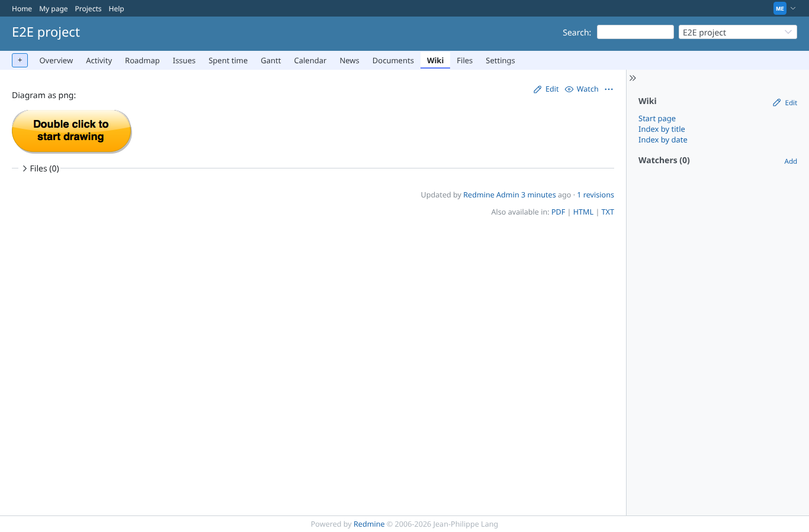

# real-diagrams-net

Run 2026-10-14T21:17:07.035Z against http://127.0.0.1:3000.

| screenshot | user | URL | shows |
|---|---|---|---|
|  | manager | `/projects/e2e-project/wiki/Drawio_png` | embed.diagrams.net is not reachable from this browser: real editor not tested here (the stub scenarios cover the save flow) |
